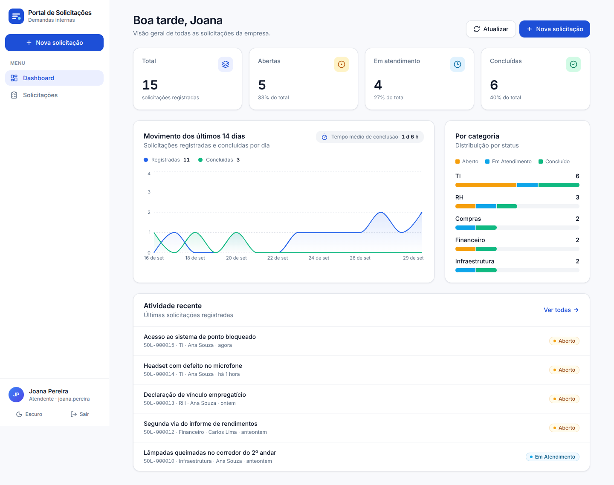
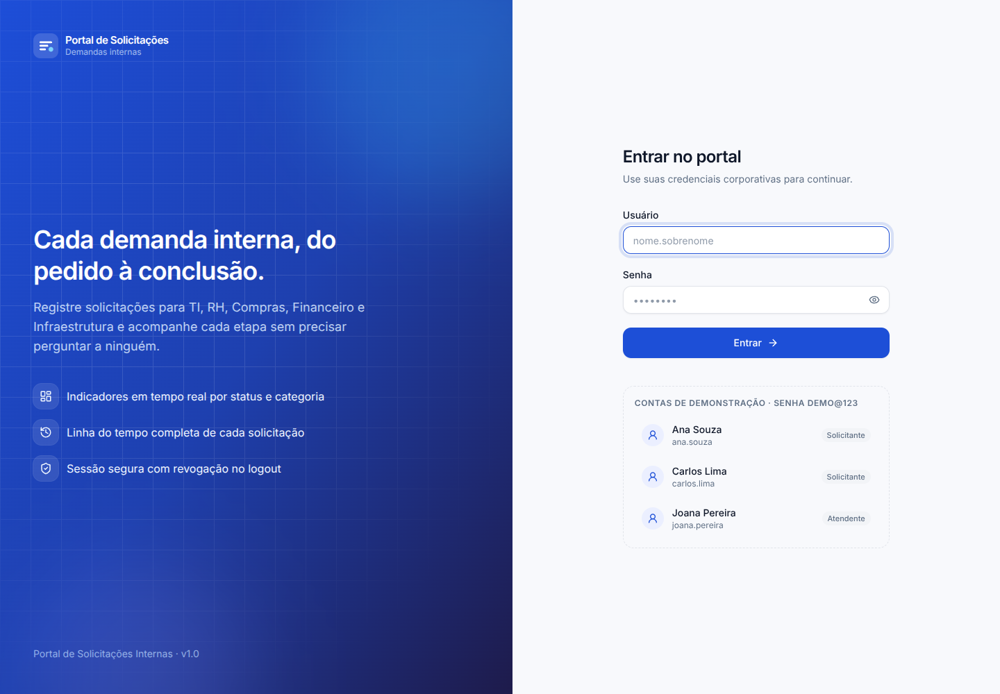
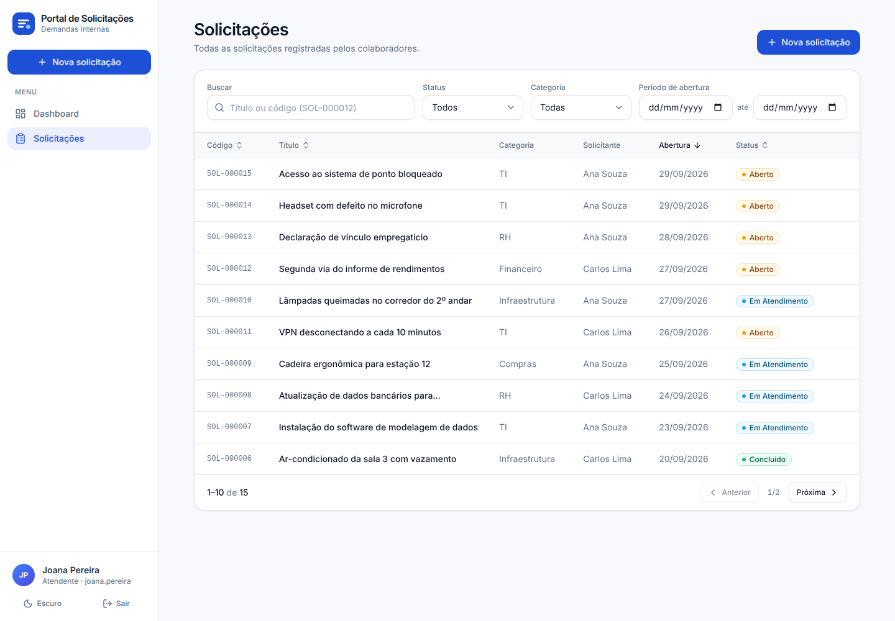
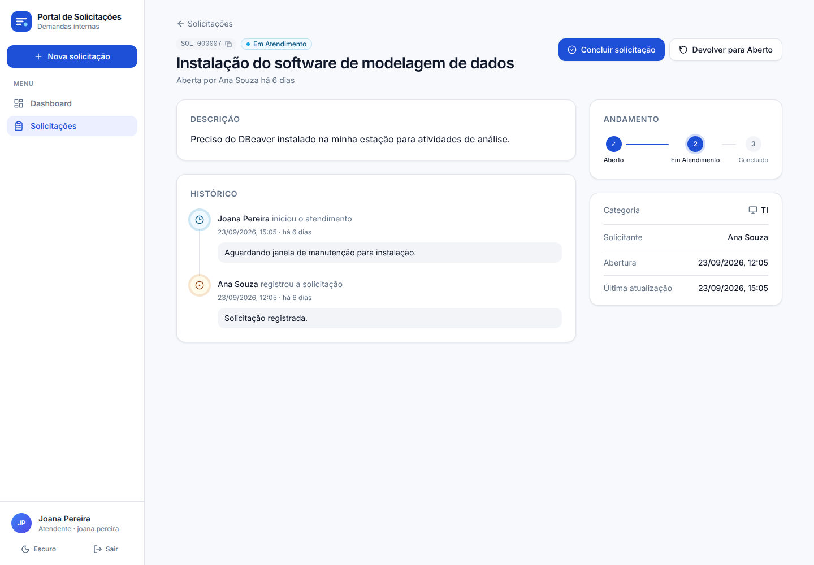
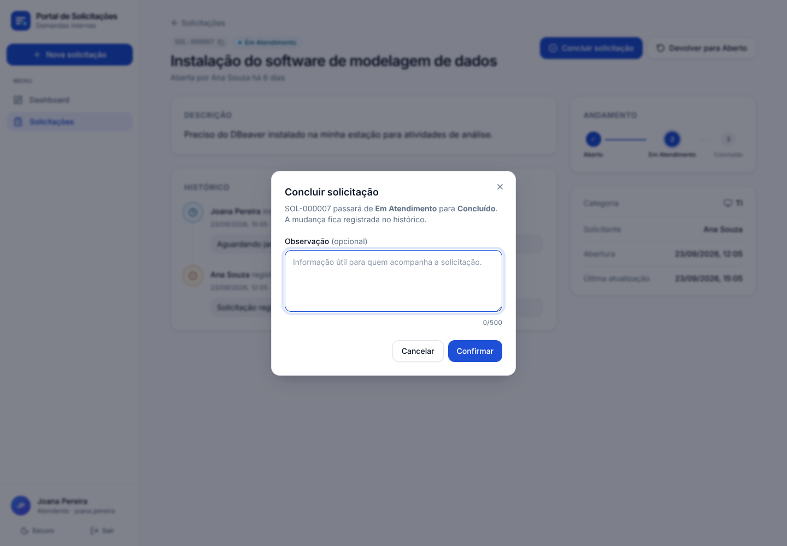
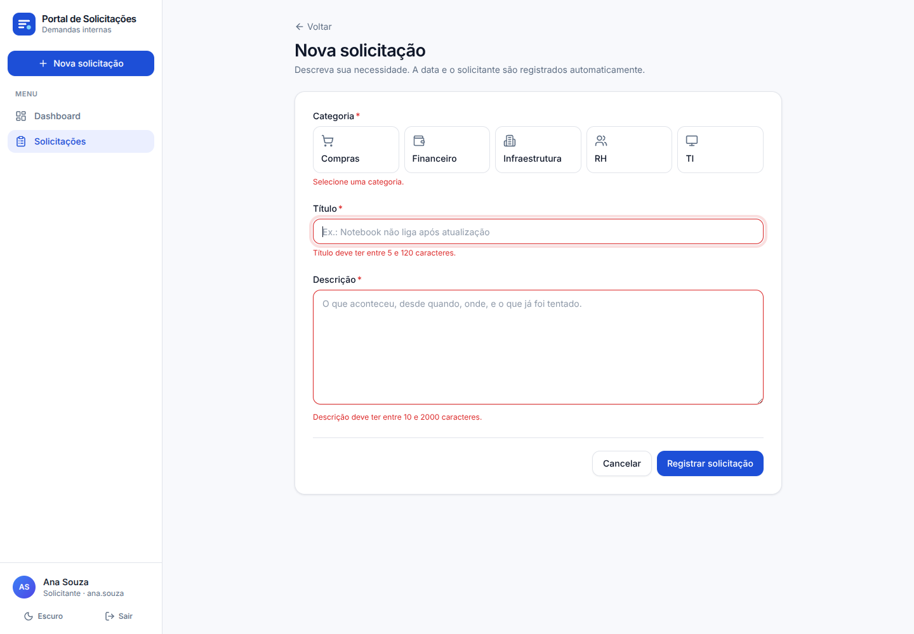
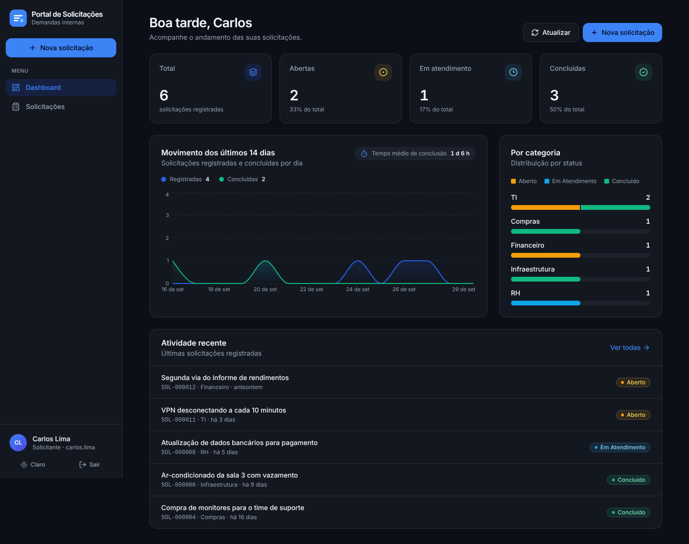
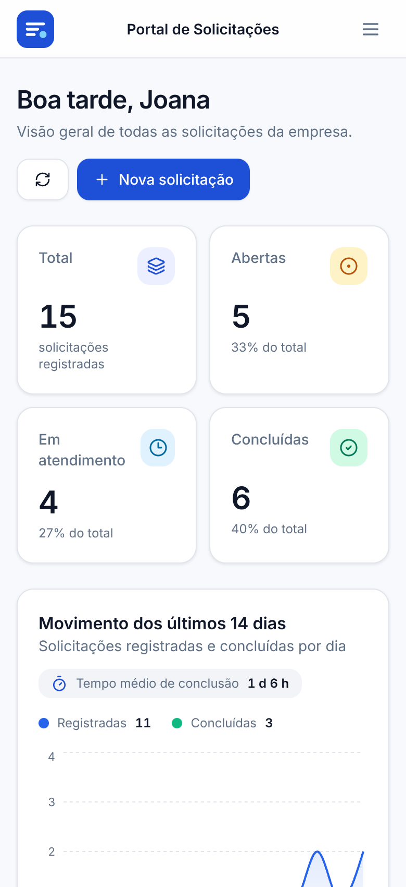
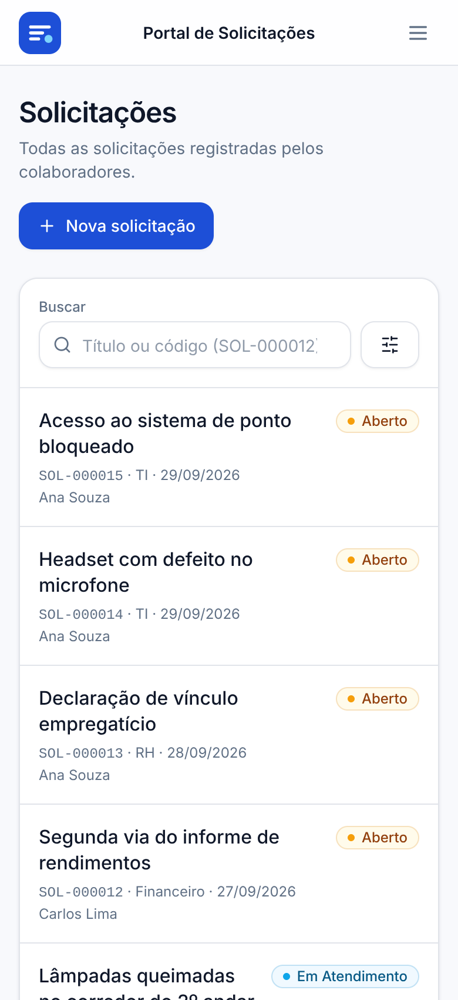

# Portal de Solicitações Internas

[](https://github.com/Annaa-Clara/portal-solicitacoes/actions/workflows/ci.yml)

Sistema web para colaboradores **registrarem demandas internas** (TI, RH, Compras, Financeiro e Infraestrutura) e **acompanharem cada uma até a conclusão**, com dashboard de indicadores, filtros, controle de acesso por perfil e linha do tempo de cada solicitação.

Desenvolvido como avaliação técnica (mini-projeto full stack) para a vaga de Desenvolvedor(a) de Sistemas Júnior da **bit Soluções**.



| | |
|---|---|
| **Frontend** | React 19 · TypeScript · Vite · Tailwind CSS · TanStack Query · React Hook Form + Zod |
| **Backend** | Node.js 22 · NestJS 11 · TypeScript · TypeORM |
| **Banco** | PostgreSQL 16 (scripts SQL versionados) |
| **Qualidade** | 72 testes automatizados · ESLint · Prettier · GitHub Actions |
| **Deploy** | Docker multi-stage · Docker Compose · Nginx |

📄 **Documentação:** [Memorial Técnico de Desenvolvimento](docs/MEMORIAL_TECNICO.md) · [Dicionário de Dados](docs/DICIONARIO_DE_DADOS.md) · [Evidências](docs/evidencias)

---

## Funcionalidades

**Requisitos do enunciado**

- **Autenticação:** login com usuário e senha, controle de sessão e logout. Todas as rotas exigem sessão.
- **Cadastro de solicitações:** título, descrição e categoria; data, solicitante e status *Aberto* preenchidos automaticamente. Edição e exclusão enquanto a solicitação está aberta.
- **Gerenciamento:** listagem com código, título, categoria, solicitante, data de abertura e status; alteração de status e consulta de detalhes.
- **Consulta e filtros:** período, categoria, status e texto livre (título).
- **Dashboard:** total de solicitações, abertas, em atendimento e concluídas.

**Além do pedido**

- **Linha do tempo** de cada solicitação: quem mudou o status, quando e por quê (tabela de histórico/auditoria).
- **Perfis:** *Solicitante* registra e acompanha as próprias demandas; *Atendente* vê todas e conduz o atendimento.
- **Fluxo de status validado no servidor:** Aberto → Em Atendimento → Concluído, com devolução para Aberto mediante motivo.
- **Dashboard ampliado:** tempo médio de conclusão, movimento dos últimos 14 dias e distribuição por categoria.
- Busca também pelo código (`SOL-000012`), ordenação por coluna, paginação e filtros na URL (compartilháveis por link).
- Tema claro/escuro, layout responsivo (celular, tablet e desktop) e acessibilidade (teclado, leitores de tela).
- Segurança: sessão revogável em cookie HttpOnly, proteção contra CSRF, limite de tentativas de login, CSP, senhas com bcrypt.
- API documentada com **Swagger** e erros padronizados (RFC 9457).
- **Docker Compose**, **testes automatizados** e **CI/CD** — os diferenciais listados no enunciado.

---

## Acesso de demonstração

Senha de todos os usuários: **`Demo@123`**

| Usuário | Perfil | O que pode fazer |
|---|---|---|
| `ana.souza` | Solicitante | Criar, editar e excluir as próprias solicitações abertas; acompanhar as próprias |
| `carlos.lima` | Solicitante | Idem (útil para verificar que um solicitante não vê as solicitações do outro) |
| `joana.pereira` | Atendente | Ver todas as solicitações e alterar status |

Na tela de login, basta clicar em uma das contas para preencher usuário e senha. O banco já inicia com 14 solicitações de exemplo em todos os status.

---

## Pré-requisitos

| Forma de execução | Requisitos |
|---|---|
| **A) Docker (recomendada)** | [Docker](https://docs.docker.com/get-docker/) com Docker Compose v2 |
| **B) Local, sem Docker** | **Node.js 20+** (recomendado 22 LTS) com npm · **PostgreSQL 13+** (recomendado 16) |

- **Linguagem:** TypeScript (executado em Node.js), no backend e no frontend.
- **Banco de dados:** PostgreSQL. A extensão `pg_trgm` (inclusa na distribuição padrão do PostgreSQL) é criada automaticamente pelo script de estrutura.
- **Dependências:** instaladas pelo `npm` a partir de `backend/package.json` e `frontend/package.json` (versões travadas nos `package-lock.json`).

---

## A) Execução com Docker (um comando)

```bash
git clone <url-do-repositorio> portal-solicitacoes
cd portal-solicitacoes
docker compose up -d --build
```

Aguarde os três serviços ficarem saudáveis (`docker compose ps`) e acesse:

| Serviço | Endereço |
|---|---|
| **Aplicação** | http://localhost:8080 |
| API | http://localhost:3000/api |
| Documentação da API (Swagger) | http://localhost:3000/api/docs |
| PostgreSQL | `localhost:5432` · banco `portal_solicitacoes` · usuário/senha `portal`/`portal` |

O banco é criado e populado automaticamente na primeira inicialização. Para parar: `docker compose down` (os dados são mantidos). Para recomeçar do zero: `docker compose down -v`.

> Se alguma porta já estiver em uso, copie `.env.example` para `.env` e ajuste `WEB_PORT`, `API_PORT` ou `DB_PORT`.

---

## B) Execução local (sem Docker)

### 1. Banco de dados

Com um PostgreSQL em execução, crie o usuário e o banco (como superusuário, ex.: `postgres`):

```bash
psql -U postgres -c "CREATE USER portal WITH PASSWORD 'portal';"
psql -U postgres -c "CREATE DATABASE portal_solicitacoes OWNER portal;"
```

**Não é preciso rodar scripts manualmente:** ao iniciar, a API aplica os scripts de [`database/migrations`](database/migrations) (tabelas, índices, categorias, usuários e dados de exemplo). Se preferir aplicá-los antes, use `npm run db:migrate` dentro de `backend/`.

> Já tem um PostgreSQL rodando em Docker? `docker compose up -d db` sobe apenas o banco, já com usuário e base criados.

### 2. Backend

```bash
cd backend
npm install
cp .env.example .env        # Windows (PowerShell): Copy-Item .env.example .env
npm run start:dev
```

A API sobe em http://localhost:3000/api e o Swagger em http://localhost:3000/api/docs.

### 3. Frontend

Em outro terminal:

```bash
cd frontend
npm install
npm run dev
```

Acesse **http://localhost:5173**. Em desenvolvimento, o Vite encaminha `/api` para `http://localhost:3000` (frontend e API na mesma origem, como em produção).

### Build de produção (opcional)

```bash
cd backend && npm run build && npm run start:prod
cd frontend && npm run build        # gera frontend/dist (servido pelo Nginx no Docker)
```

---

## Configuração

### Variáveis de ambiente do backend (`backend/.env`)

A API valida todas as variáveis ao iniciar e não sobe com configuração inválida. Todas, exceto as de conexão, têm valor padrão.

| Variável | Padrão | Descrição |
|---|---|---|
| `NODE_ENV` | `development` | `development`, `production` ou `test` |
| `PORT` | `3000` | Porta HTTP da API |
| `DATABASE_HOST` | — | Host do PostgreSQL |
| `DATABASE_PORT` | `5432` | Porta do PostgreSQL |
| `DATABASE_USER` | — | Usuário do banco |
| `DATABASE_PASSWORD` | — | Senha do banco |
| `DATABASE_NAME` | — | Nome do banco |
| `DATABASE_MIGRATE_ON_START` | `true` | Aplica os scripts SQL pendentes ao iniciar |
| `MIGRATIONS_DIR` | auto | Pasta dos scripts (procura `database/migrations` e `../database/migrations`) |
| `SESSION_IDLE_MINUTES` | `120` | Minutos sem atividade até a sessão expirar |
| `SESSION_MAX_HOURS` | `12` | Duração máxima de uma sessão |
| `COOKIE_SECURE` | `false` | Use `true` quando servido via HTTPS |
| `CORS_ORIGINS` | `http://localhost:5173` | Origens autorizadas (separadas por vírgula) |
| `TRUST_PROXY` | `false` | `true` atrás de proxy reverso (Nginx), para identificar o IP real |
| `APP_TIMEZONE` | `America/Fortaleza` | Fuso usado nos filtros de período e no dashboard |
| `SWAGGER_ENABLED` | `true` | Publica a documentação em `/api/docs` |

O frontend não precisa de variáveis: ele sempre chama a API pelo caminho relativo `/api`.

### Variáveis do Docker Compose (`.env` na raiz, opcional)

`POSTGRES_USER`, `POSTGRES_PASSWORD`, `POSTGRES_DB`, `WEB_PORT` (8080), `API_PORT` (3000), `DB_PORT` (5432), `SESSION_IDLE_MINUTES`, `SESSION_MAX_HOURS`, `COOKIE_SECURE`. Veja [`.env.example`](.env.example).

### Credenciais de demonstração

| Item | Valor |
|---|---|
| Usuários da aplicação | `ana.souza`, `carlos.lima` (Solicitantes) e `joana.pereira` (Atendente) |
| Senha da aplicação | `Demo@123` |
| Banco de dados | usuário `portal`, senha `portal`, base `portal_solicitacoes` |

---

## Testes

```bash
# Backend
cd backend
npm test                 # 27 testes unitários (regras de negócio, migrations, configuração)
npm run test:e2e         # 32 testes end-to-end contra PostgreSQL real
npm run test:e2e:cov     # e2e com relatório de cobertura (~95% das linhas)
npm run lint

# Frontend
cd frontend
npm test                 # 13 testes (cliente HTTP, formatação, tela de login, componentes)
npm run lint
```

Os testes end-to-end usam um banco **separado** (`portal_solicitacoes_test`, configurável por `DATABASE_NAME_TEST`), que é recriado e migrado a cada execução. Crie-o uma vez:

```bash
psql -U postgres -c "CREATE DATABASE portal_solicitacoes_test OWNER portal;"
```

---

## CI/CD

O workflow [`.github/workflows/ci.yml`](.github/workflows/ci.yml) roda a cada push e pull request:

1. **Backend:** lint, checagem de tipos, testes unitários, testes e2e (PostgreSQL como serviço) e build.
2. **Frontend:** lint, testes e build.
3. **Docker:** sobe o `docker-compose` completo e faz login pelo proxy do frontend (smoke test).
4. **Publicação (apenas na `main`):** envia as imagens do backend e do frontend ao GitHub Container Registry.

---

## API

Documentação interativa em **`/api/docs`** (Swagger). Principais endpoints:

| Método | Rota | Descrição |
|---|---|---|
| `POST` | `/api/auth/login` | Login (cria sessão em cookie HttpOnly) |
| `POST` | `/api/auth/logout` | Logout (revoga a sessão) |
| `GET` | `/api/auth/me` | Usuário da sessão |
| `GET` | `/api/categorias` | Categorias ativas |
| `GET` | `/api/solicitacoes` | Lista (`status`, `categoriaId`, `dataInicio`, `dataFim`, `texto`, `pagina`, `tamanho`, `ordenarPor`, `direcao`) |
| `GET` | `/api/solicitacoes/:id` | Detalhe, histórico e ações permitidas |
| `POST` | `/api/solicitacoes` | Cria solicitação |
| `PUT` | `/api/solicitacoes/:id` | Edita solicitação aberta |
| `DELETE` | `/api/solicitacoes/:id` | Exclui solicitação aberta |
| `PATCH` | `/api/solicitacoes/:id/status` | Altera status (atendente) |
| `GET` | `/api/dashboard` | Indicadores |
| `GET` | `/api/health` | Saúde da API e do banco |

Exemplo com `curl`:

```bash
curl -c cookie.txt -H "Content-Type: application/json" \
  -d '{"usuario":"ana.souza","senha":"Demo@123"}' http://localhost:3000/api/auth/login

curl -b cookie.txt "http://localhost:3000/api/solicitacoes?status=ABERTO&texto=notebook"
```

Erros seguem o formato *Problem Details* (RFC 9457):

```json
{
  "type": "about:blank",
  "title": "Requisição inválida",
  "status": 400,
  "detail": "Um ou mais campos são inválidos.",
  "instance": "/api/solicitacoes",
  "requestId": "3f1c0f0e-...",
  "timestamp": "2026-09-30T13:00:00.000Z",
  "erros": [{ "campo": "titulo", "mensagem": "Título deve ter entre 5 e 120 caracteres." }]
}
```

---

## Estrutura do projeto

```
portal-solicitacoes/
├── backend/                  API NestJS
│   ├── src/
│   │   ├── common/           guards, decorators, filtro de erros, middlewares
│   │   ├── config/           validação de variáveis de ambiente
│   │   ├── database/         runner de migrations e configuração do TypeORM
│   │   └── modules/          auth · categorias · solicitacoes · dashboard · health
│   └── test/                 testes end-to-end
├── frontend/                 SPA React
│   └── src/
│       ├── components/       ui/ (componentes reutilizáveis) e layout/
│       ├── features/         auth · solicitacoes · dashboard
│       └── lib/ hooks/ types/
├── database/migrations/      scripts SQL (estrutura + dados iniciais)
├── docs/                     memorial técnico, dicionário de dados, evidências
├── docker-compose.yml
└── .github/workflows/ci.yml
```

---

## Evidências

Capturas da aplicação em funcionamento em [`docs/evidencias`](docs/evidencias):

| | |
|---|---|
|  |  |
| Login com contas de demonstração | Listagem com filtros e ordenação |
|  |  |
| Detalhe com linha do tempo | Alteração de status pelo atendente |
|  |  |
| Validação do formulário | Dashboard do solicitante (tema escuro) |

<p align="center">
  
  &nbsp;&nbsp;
  
</p>
