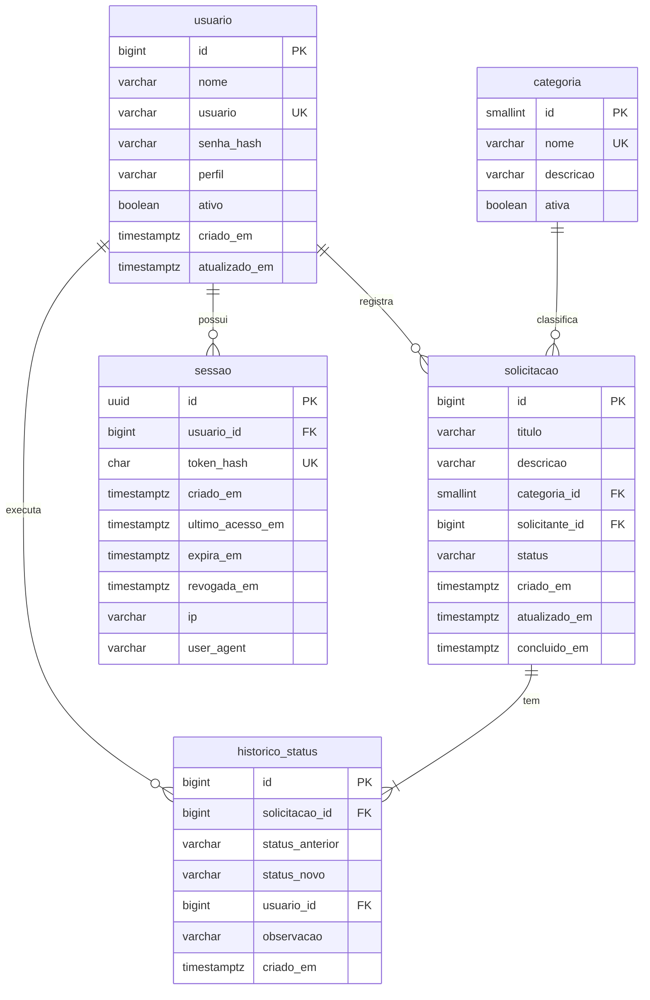

# Dicionário de Dados

Banco: **PostgreSQL 16** · Scripts: [`database/migrations`](../database/migrations) · Convenções: nomes em português, `snake_case`, singular; datas em `TIMESTAMPTZ` (armazenadas em UTC, exibidas no fuso da empresa).

## Modelo entidade-relacionamento



## Tabelas

### `usuario`
Pessoas autorizadas a acessar o portal.

| Coluna | Tipo | Nulo | Padrão | Descrição |
|---|---|---|---|---|
| `id` | `BIGINT` identity | Não | gerado | Chave primária. |
| `nome` | `VARCHAR(120)` | Não | — | Nome exibido na interface. |
| `usuario` | `VARCHAR(50)` | Não | — | Login. Único e sempre em minúsculas (`ck_usuario_login`). |
| `senha_hash` | `VARCHAR(72)` | Não | — | Hash **bcrypt** (custo 10). A senha em texto puro nunca é armazenada. |
| `perfil` | `VARCHAR(20)` | Não | — | `SOLICITANTE` ou `ATENDENTE` (`ck_usuario_perfil`). |
| `ativo` | `BOOLEAN` | Não | `TRUE` | Usuário inativo não autentica e perde as sessões existentes. |
| `criado_em` | `TIMESTAMPTZ` | Não | `NOW()` | Data de cadastro. |
| `atualizado_em` | `TIMESTAMPTZ` | Não | `NOW()` | Última alteração do cadastro. |

Restrições: `uk_usuario_usuario` (único), `ck_usuario_perfil`, `ck_usuario_login`.

### `sessao`
Controle de sessão *server-side*. Permite logout real (revogação) e expiração por inatividade.

| Coluna | Tipo | Nulo | Padrão | Descrição |
|---|---|---|---|---|
| `id` | `UUID` | Não | — | Chave primária (gerada pela aplicação). |
| `usuario_id` | `BIGINT` | Não | — | FK → `usuario.id` (`ON DELETE CASCADE`). |
| `token_hash` | `CHAR(64)` | Não | — | SHA-256 do token. O token em si só existe no cookie HttpOnly do navegador. |
| `criado_em` | `TIMESTAMPTZ` | Não | `NOW()` | Início da sessão (base da duração máxima). |
| `ultimo_acesso_em` | `TIMESTAMPTZ` | Não | `NOW()` | Última atividade registrada (renovada no máximo 1x por minuto). |
| `expira_em` | `TIMESTAMPTZ` | Não | — | Expiração deslizante: `min(agora + inatividade, criado_em + duração máxima)`. |
| `revogada_em` | `TIMESTAMPTZ` | Sim | — | Preenchida no logout. Sessão revogada nunca volta a valer. |
| `ip` | `VARCHAR(45)` | Sim | — | IP de origem do login (IPv4 ou IPv6), para auditoria. |
| `user_agent` | `VARCHAR(255)` | Sim | — | Navegador do login, para auditoria. |

Índices: `uk_sessao_token_hash` (busca do token a cada requisição), `ix_sessao_usuario`.

### `categoria`
Áreas que recebem as solicitações. É tabela (e não *enum*) para que novas categorias sejam incluídas sem alterar código.

| Coluna | Tipo | Nulo | Padrão | Descrição |
|---|---|---|---|---|
| `id` | `SMALLINT` identity | Não | gerado | Chave primária. |
| `nome` | `VARCHAR(40)` | Não | — | Nome único: TI, RH, Compras, Financeiro, Infraestrutura. |
| `descricao` | `VARCHAR(160)` | Sim | — | Texto de apoio exibido no formulário. |
| `ativa` | `BOOLEAN` | Não | `TRUE` | Categoria inativa não aceita novas solicitações, mas preserva o histórico. |

### `solicitacao`
Demanda interna registrada por um colaborador.

| Coluna | Tipo | Nulo | Padrão | Descrição |
|---|---|---|---|---|
| `id` | `BIGINT` identity | Não | gerado | Chave primária. Exibida como **código** `SOL-000001`. |
| `titulo` | `VARCHAR(120)` | Não | — | Resumo da demanda (mínimo 5 caracteres, `ck_solicitacao_titulo`). |
| `descricao` | `VARCHAR(2000)` | Não | — | Detalhamento (10 a 2000 caracteres, validado na API). |
| `categoria_id` | `SMALLINT` | Não | — | FK → `categoria.id`. |
| `solicitante_id` | `BIGINT` | Não | — | FK → `usuario.id`. **Automático**: usuário da sessão. |
| `status` | `VARCHAR(20)` | Não | `'ABERTO'` | `ABERTO`, `EM_ATENDIMENTO` ou `CONCLUIDO` (`ck_solicitacao_status`). |
| `criado_em` | `TIMESTAMPTZ` | Não | `NOW()` | Data de abertura. **Automático**. |
| `atualizado_em` | `TIMESTAMPTZ` | Não | `NOW()` | Última alteração (edição ou mudança de status). |
| `concluido_em` | `TIMESTAMPTZ` | Sim | — | Momento da conclusão. Base do indicador de tempo médio de atendimento. |

Restrições:
- `ck_solicitacao_conclusao`: `concluido_em` preenchido **se e somente se** `status = 'CONCLUIDO'` — a regra vale mesmo que alguém altere o banco por fora da aplicação.
- Índices alinhados aos filtros da tela: `ix_solicitacao_status`, `ix_solicitacao_categoria`, `ix_solicitacao_solicitante`, `ix_solicitacao_criado_em` (ordenação padrão) e `ix_solicitacao_titulo_trgm` (GIN com `pg_trgm`, acelera o `ILIKE '%termo%'` da busca por texto livre).

### `historico_status`
Trilha de auditoria: a linha do tempo de cada solicitação.

| Coluna | Tipo | Nulo | Padrão | Descrição |
|---|---|---|---|---|
| `id` | `BIGINT` identity | Não | gerado | Chave primária. |
| `solicitacao_id` | `BIGINT` | Não | — | FK → `solicitacao.id` (`ON DELETE CASCADE`). |
| `status_anterior` | `VARCHAR(20)` | Sim | — | Status antes da mudança. **Nulo** no registro de criação. |
| `status_novo` | `VARCHAR(20)` | Não | — | Status após a mudança. |
| `usuario_id` | `BIGINT` | Não | — | FK → `usuario.id`. Quem executou a ação. |
| `observacao` | `VARCHAR(500)` | Sim | — | Comentário do atendente. **Obrigatório** ao devolver para Aberto (regra da API). |
| `criado_em` | `TIMESTAMPTZ` | Não | `NOW()` | Momento da mudança. |

Índice: `ix_historico_solicitacao (solicitacao_id, criado_em)` — carrega a linha do tempo já ordenada.

### `schema_migrations` (controle)
Criada pelo runner de migrations. Registra `versao`, `descricao`, `checksum` (SHA-256 do script), `aplicado_em` e `duracao_ms`. Se um script já aplicado for alterado, a aplicação se recusa a subir.

## Domínios de valores

| Domínio | Valores | Observação |
|---|---|---|
| Perfil | `SOLICITANTE`, `ATENDENTE` | Solicitante registra e acompanha as próprias demandas; atendente vê todas e altera status. |
| Status | `ABERTO` → `EM_ATENDIMENTO` → `CONCLUIDO` | Também é permitido `EM_ATENDIMENTO` → `ABERTO` (devolução com motivo). `CONCLUIDO` é final. |

## Scripts

| Arquivo | Conteúdo |
|---|---|
| `V001__estrutura_inicial.sql` | Tabelas, restrições, índices e comentários (`COMMENT ON`). |
| `V002__dados_referencia.sql` | Categorias e usuários de demonstração. |
| `V003__solicitacoes_demonstracao.sql` | 14 solicitações em todos os status, com histórico coerente e datas relativas à instalação. |

Formas de execução:

```bash
# 1) Automática: a API aplica as versões pendentes ao iniciar (DATABASE_MIGRATE_ON_START=true, padrão)
# 2) Manual, pelo mesmo runner (registra em schema_migrations):
cd backend && npm run db:migrate
# 3) SQL puro, pelo psql, na ordem V001 -> V002 -> V003 (útil para inspecionar o banco sem a API).
#    Neste caso, suba a API com DATABASE_MIGRATE_ON_START=false, pois schema_migrations não é preenchida.
psql -U portal -d portal_solicitacoes -f database/migrations/V001__estrutura_inicial.sql
```
