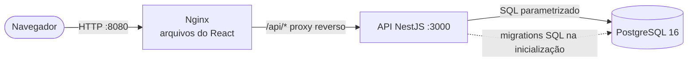
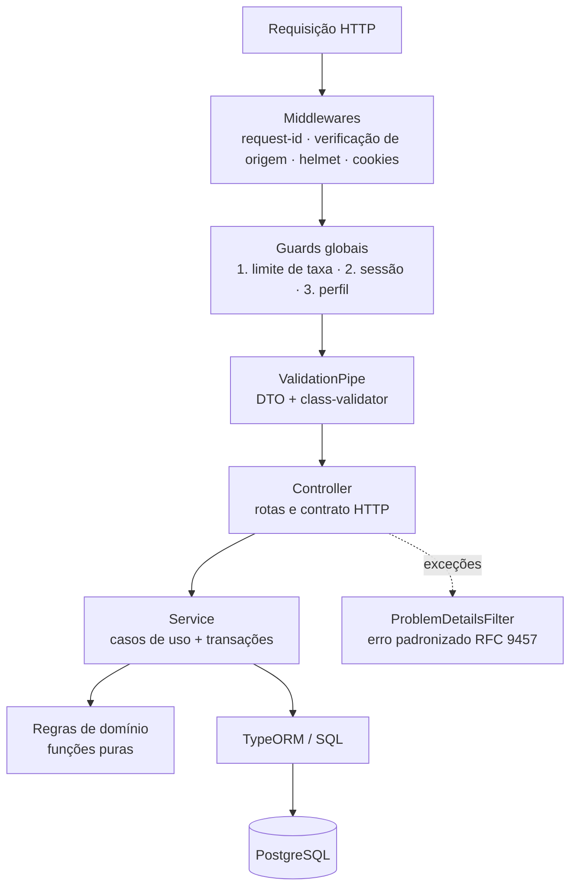

# Memorial Técnico de Desenvolvimento

| | |
|---|---|
| **Projeto** | Portal de Solicitações Internas |
| **Processo seletivo** | Desenvolvedor(a) de Sistemas Júnior — bit Soluções |
| **Autora** | Anna Clara de Medeiros Gonçalves |
| **Versão** | 1.0 — setembro de 2026 |

---

## Sumário

1. [Visão geral da solução](#1-visão-geral-da-solução)
2. [Tecnologias utilizadas](#2-tecnologias-utilizadas)
3. [Justificativa técnica](#3-justificativa-técnica)
4. [Justificativa conceitual](#4-justificativa-conceitual)
5. [Interpretação dos requisitos e regras de negócio](#5-interpretação-dos-requisitos-e-regras-de-negócio)
6. [Segurança](#6-segurança)
7. [Qualidade: testes, CI/CD e experiência do usuário](#7-qualidade-testes-cicd-e-experiência-do-usuário)
8. [Análise crítica](#8-análise-crítica)
9. [Rastreabilidade: requisito → implementação](#9-rastreabilidade-requisito--implementação)

---

## 1. Visão geral da solução

O portal permite que colaboradores registrem demandas internas (TI, RH, Compras, Financeiro e Infraestrutura) e acompanhem cada uma até a conclusão. A aplicação é composta por três partes independentes:

| Parte | Responsabilidade |
|---|---|
| **Frontend** (React + TypeScript) | Interface web responsiva: login, dashboard, listagem com filtros, cadastro/edição e detalhe com linha do tempo. |
| **Backend** (NestJS + TypeScript) | API REST: autenticação, regras de negócio, validação, autorização e persistência. |
| **Banco** (PostgreSQL 16) | Persistência relacional, com estrutura criada por scripts SQL versionados. |



Três pontos orientaram todas as decisões:

1. **Cumprir todos os requisitos com correção**, antes de qualquer extra.
2. **Regras de negócio no servidor**, nunca só na interface. O frontend esconde botões por usabilidade; quem garante a regra é a API.
3. **Resolver o problema real do enunciado**: "acompanhar a evolução até a conclusão". Uma listagem mostra apenas o *estado atual*; por isso a solução registra o **histórico de cada mudança de status** e o exibe como linha do tempo.

---

## 2. Tecnologias utilizadas

| Categoria | Tecnologia | Versão |
|---|---|---|
| Linguagem (back e front) | TypeScript | 5.9 |
| Runtime | Node.js | 22 LTS |
| Framework backend | NestJS | 11 |
| ORM / acesso a dados | TypeORM + driver `pg` | 0.3 / 8 |
| Banco de dados | PostgreSQL (extensão `pg_trgm`) | 16 |
| Migrations | Runner próprio de scripts SQL versionados (estilo Flyway) | — |
| Validação (backend) | class-validator + class-transformer | 0.14 / 0.5 |
| Autenticação | Sessão server-side com token opaco em cookie HttpOnly; senhas com bcrypt (`bcryptjs`) | 3 |
| Segurança HTTP | Helmet, `@nestjs/throttler` (limite de tentativas), CORS restrito, verificação de Origin | 8 / 6 |
| Documentação da API | OpenAPI / Swagger (`@nestjs/swagger`) | 11 |
| Framework frontend | React | 19 |
| Build frontend | Vite | 7 |
| Roteamento | React Router | 7 |
| Estado de servidor / cache | TanStack Query | 5 |
| Formulários e validação (frontend) | React Hook Form + Zod | 7 / 3 |
| Estilo | Tailwind CSS | 3.4 |
| Gráficos | Recharts | 2 |
| Ícones / notificações | Lucide / Sonner | — |
| Testes backend | Jest + Supertest (unitários e end-to-end com PostgreSQL real) | 29 / 7 |
| Testes frontend | Vitest + Testing Library | 3 / 16 |
| Qualidade de código | ESLint + Prettier (+ plugin de ordenação de classes Tailwind) | 9 / 3 |
| Containerização | Docker (multi-stage) + Docker Compose | — |
| Servidor web / proxy | Nginx | 1.27 |
| CI/CD | GitHub Actions + GitHub Container Registry | — |

---

## 3. Justificativa técnica

### 3.1 TypeScript em toda a aplicação

- **Motivo:** uma única linguagem, com tipagem estática, no frontend e no backend.
- **Benefícios:** erros de contrato (um campo renomeado, um status digitado errado) aparecem na compilação, não em produção. Os tipos de status e perfis (`'ABERTO' | 'EM_ATENDIMENTO' | 'CONCLUIDO'`) são verificados pelo compilador em todo o código.
- **Vantagens sobre alternativas:** JavaScript puro não oferece essa garantia; usar linguagens diferentes em cada camada (ex.: Java + JavaScript) exige duplicar modelos e aumenta a troca de contexto.
- **Impacto:** refatorações mais seguras e leitura mais fácil do código por quem chega ao projeto — o tipo documenta a intenção.

### 3.2 NestJS (backend)

- **Motivo:** framework que impõe uma arquitetura em camadas — módulos, controllers, services, injeção de dependência, guards, pipes e filtros — em vez de deixar a organização a critério de cada arquivo.
- **Benefícios para o cenário:** cada requisito do enunciado tem um lugar natural: autenticação em *guard*, validação em *pipe*, tratamento de erros em *exception filter*, regra de negócio em *service*. Isso atende diretamente aos critérios "uso adequado de camadas" e "separação de responsabilidades".
- **Vantagens sobre alternativas:** em relação ao Express puro, evita que a estrutura dependa de disciplina manual. A arquitetura é muito próxima à do Spring Boot (módulos ≈ configurações, `@Injectable` ≈ `@Service`, guards ≈ filtros do Spring Security), o que torna o código familiar para equipes que trabalham com Java ou C#.
- **Impacto:** manutenção previsível; novos módulos (ex.: anexos, notificações) seguem o mesmo molde. A injeção de dependência facilita testes com implementações substituídas.

### 3.3 PostgreSQL 16

- **Motivo:** banco relacional robusto, gratuito e padrão de mercado.
- **Benefícios:** o domínio é naturalmente relacional (usuário → solicitação → histórico). Uso de recursos que simplificam o código: `CHECK constraints` para garantir regras no próprio banco, `COUNT(*) FILTER (...)` para calcular o dashboard em uma única consulta, `TIMESTAMPTZ` para datas corretas em qualquer fuso e a extensão `pg_trgm` para busca textual indexada.
- **Vantagens sobre alternativas:** frente ao MySQL, oferece `FILTER`, `CHECK` confiável e índices trigram nativos; frente ao SQLite, suporta concorrência real e bloqueio de linha (`SELECT ... FOR UPDATE`), usado na mudança de status; frente a um banco NoSQL, garante integridade referencial, essencial para trilha de auditoria.
- **Impacto:** a integridade não depende só da aplicação; escala com folga para o volume de uma empresa (milhões de linhas com os índices definidos).

### 3.4 TypeORM + scripts SQL versionados

- **Motivo:** o TypeORM mapeia as entidades para as consultas do dia a dia; a **estrutura** do banco, porém, é criada exclusivamente por scripts SQL (`synchronize: false`).
- **Benefícios:** o enunciado pede "scripts SQL ou mecanismo equivalente" — os scripts são SQL puro, legíveis, executáveis pelo `psql` e ao mesmo tempo aplicados automaticamente pela API. Um runner próprio (≈ 100 linhas) garante que cada versão rode uma única vez, em transação, com *checksum* (um script já aplicado não pode ser editado) e *advisory lock* (duas instâncias não migram o banco ao mesmo tempo).
- **Vantagens sobre alternativas:** `synchronize` do ORM altera o banco de forma implícita e perigosa; migrations geradas pelo ORM são menos legíveis para quem avalia o banco. Prisma exige baixar binários do motor e usa uma linguagem de schema própria. Em Java, o equivalente seria Flyway — o runner segue exatamente o mesmo modelo.
- **Impacto:** o banco é versionado junto com o código; qualquer ambiente (local, Docker, CI) chega ao mesmo estado.
- **Consultas:** todas parametrizadas (Query Builder ou `$1, $2`), o que elimina SQL injection. Filtros de texto escapam `%` e `_` para que o usuário não injete curingas.

### 3.5 Validação com class-validator (backend) e Zod (frontend)

- **Motivo:** validação declarativa, próxima dos dados.
- **Benefícios:** no backend, cada DTO declara suas regras com mensagens em português; o `ValidationPipe` global rejeita campos desconhecidos (`forbidNonWhitelisted`), impedindo, por exemplo, que um cliente envie `status: "CONCLUIDO"` ao criar uma solicitação. No frontend, o Zod repete as regras de tamanho para dar resposta imediata ao usuário — **a validação definitiva continua sendo a da API**, cujos erros por campo também são exibidos no formulário.
- **Vantagens:** evita `if`s espalhados pelos services; as regras ficam visíveis em um único lugar e aparecem automaticamente na documentação Swagger.

### 3.6 Autenticação: sessão server-side com cookie HttpOnly

- **Motivo:** o enunciado pede login, **controle de sessão** e **logout**.
- **Como funciona:** no login é gerado um token aleatório de 256 bits, enviado ao navegador em cookie `HttpOnly`, `SameSite=Strict`. O banco guarda somente o **hash SHA-256** do token, com expiração deslizante (2 h sem uso) e duração máxima (12 h). O logout revoga a sessão no servidor.
- **Vantagens sobre JWT:** um JWT puro não pode ser invalidado antes de expirar — o "logout" apenas apaga o token do navegador, e uma cópia roubada continua válida. Com a sessão no banco, o logout é real, é possível encerrar todas as sessões de um usuário e desativar um usuário tem efeito imediato. Guardar o JWT em `localStorage` (padrão comum) também o expõe a XSS; o cookie HttpOnly não é acessível por JavaScript.
- **Custo aceito:** uma consulta indexada por requisição autenticada — irrelevante neste volume e contornável com cache (ver análise crítica).

### 3.7 React 19 + Vite

- **Motivo:** biblioteca de UI mais adotada do mercado, com Vite como ferramenta de build.
- **Benefícios:** componentes reutilizáveis (botão, campos, diálogo, badge de status, paginação) usados em todas as telas; Vite oferece recarga instantânea em desenvolvimento e build otimizado com divisão de código (o dashboard e a biblioteca de gráficos são carregados sob demanda).
- **Vantagens sobre alternativas:** Create React App está descontinuado; Next.js adicionaria renderização no servidor, desnecessária para um sistema interno autenticado; Angular seria mais verboso para o tamanho do projeto.

### 3.8 TanStack Query

- **Motivo:** gerenciar o "estado do servidor" (dados vindos da API) separadamente do estado da interface.
- **Benefícios:** cache, estados de carregamento/erro, cancelamento de requisições obsoletas e invalidação automática — ao alterar um status, a lista e o dashboard são atualizados sem código manual. Também centraliza o tratamento de sessão expirada: qualquer resposta 401 leva o usuário de volta ao login com aviso.
- **Vantagens:** substitui dezenas de `useEffect` + `useState` repetidos e evita Redux, que seria excessivo para este escopo.

### 3.9 React Hook Form

- **Motivo:** formulários performáticos e integrados ao Zod.
- **Benefícios:** controle de erros por campo, foco no primeiro campo inválido, estado de envio (evita duplo clique) e mapeamento dos erros vindos da API para os campos corretos.

### 3.10 Tailwind CSS

- **Motivo:** estilização consistente sem CSS global crescente.
- **Benefícios:** design system definido por **tokens** (cores da marca, superfície, borda, texto) em variáveis CSS, o que tornou o **tema escuro** uma troca de variáveis e não uma reescrita. Responsividade declarada no próprio componente (`sm:`, `lg:`).
- **Vantagens:** frente a bibliotecas prontas (Material UI, Bootstrap), gera um bundle menor e uma identidade visual própria; frente a CSS puro, evita conflitos de nomes e estilos órfãos.

### 3.11 Recharts, Lucide e Sonner

- **Recharts:** gráficos declarativos em React para o dashboard (movimento diário). A distribuição por categoria foi feita em HTML/CSS simples — não precisava de biblioteca.
- **Lucide:** ícones SVG leves e consistentes (apenas os ícones usados entram no bundle).
- **Sonner:** notificações não bloqueantes ("Solicitação registrada", "Sessão expirada").

### 3.12 Jest, Supertest, Vitest e Testing Library

- **Motivo:** garantir que requisitos e regras continuem funcionando a cada alteração.
- **Estratégia:** testes unitários nas regras de negócio puras (máquina de estados, permissões) e **testes end-to-end que sobem a aplicação real contra um PostgreSQL real**, recriado e migrado pelos mesmos scripts de produção. Mocks de banco foram evitados de propósito: eles não detectariam, por exemplo, um erro de SQL ou de fuso horário no filtro de período.
- **Resultado:** 27 testes unitários + 32 end-to-end no backend (cobertura de linhas ≈ 95% nos e2e) e 13 testes no frontend.

### 3.13 Docker, Docker Compose e Nginx

- **Motivo:** o enunciado exige que o sistema rode "sem necessidade de adaptações".
- **Benefícios:** `docker compose up -d --build` sobe banco, API e frontend, com *healthchecks* e ordem de inicialização garantida. Imagens *multi-stage* (a imagem final da API não contém compilador nem dependências de desenvolvimento) e processo executado sem privilégios de root.
- **Nginx:** serve o React compilado e faz proxy de `/api` para o backend. Assim, frontend e API ficam na **mesma origem** — o cookie `SameSite=Strict` funciona sem CORS e o backend não precisa ser exposto ao navegador. Também aplica cabeçalhos de segurança (CSP estrita), compressão gzip e cache de longo prazo para arquivos com hash.

### 3.14 GitHub Actions (CI/CD) e GHCR

- **CI:** a cada push/PR executa lint, checagem de tipos, testes unitários, testes e2e (com PostgreSQL como serviço), build do front e do back e um **smoke test** que sobe o `docker-compose` completo e faz login pelo proxy.
- **CD:** em `main`, publica as imagens versionadas (tag `latest` e SHA do commit) no GitHub Container Registry, prontas para deploy em qualquer ambiente com Docker.

---

## 4. Justificativa conceitual

### 4.1 Estrutura geral

Aplicação em três camadas físicas (apresentação, API, dados), com comunicação exclusivamente via API REST/JSON. Frontend e backend são projetos independentes (cada um com seu `package.json`, testes e Dockerfile) no mesmo repositório (*monorepo*), o que facilita a avaliação e mantém a possibilidade de deploy separado.

```
portal-solicitacoes/
├── backend/               API NestJS
├── frontend/              SPA React
├── database/migrations/   Scripts SQL versionados (fonte única do esquema)
├── docs/                  Memorial, dicionário de dados, evidências
├── docker-compose.yml
└── .github/workflows/     Pipeline CI/CD
```

### 4.2 Organização das camadas no backend



| Camada | Responsabilidade | Não faz |
|---|---|---|
| **Controller** | Mapeia rota → caso de uso, documenta o contrato (Swagger), define status HTTP | Não contém regra de negócio nem SQL |
| **DTO** | Formato e validação da entrada; formato da saída | Não acessa banco |
| **Service** | Orquestra o caso de uso, abre transações, aplica bloqueios, lança erros de negócio | Não conhece HTTP (request/response) |
| **Domínio** (`regras-solicitacao.ts`) | Máquina de estados e permissões, em **funções puras** | Não depende de framework nem de banco |
| **Entidade** | Mapeamento objeto-relacional | Não contém regra |

Isolar as regras em funções puras teve dois ganhos: são testadas em milissegundos, sem banco, e são a **fonte única** das permissões enviadas ao frontend (ver 4.6).

### 4.3 Estratégia de modelagem de dados

- **Normalização (3FN):** categoria e usuário são tabelas referenciadas por chave estrangeira; nada é duplicado na solicitação.
- **Histórico como tabela própria (`historico_status`):** cada mudança gera uma linha com status anterior, novo status, autor, observação e data. É uma trilha de auditoria *append-only*: nunca é editada. Isso permite a linha do tempo e métricas como o tempo médio de conclusão.
- **Categoria como tabela, não *enum*:** novas áreas entram por `INSERT`, sem deploy. Categorias podem ser inativadas sem perder o histórico.
- **Status como `VARCHAR` + `CHECK`:** legível em consultas e relatórios, com integridade garantida pelo banco. Um `ENUM` nativo do PostgreSQL é mais difícil de evoluir (remoção/renomeação de valores).
- **Integridade no banco, não só no código:** `ck_solicitacao_conclusao` garante que `concluido_em` exista se, e somente se, o status for Concluído; `ck_usuario_login` garante logins em minúsculas.
- **Datas em `TIMESTAMPTZ`:** o filtro de período converte o dia civil informado pelo usuário (fuso `America/Fortaleza`, configurável) em um intervalo de instantes — evitando o erro clássico de uma solicitação criada às 22h "sumir" do filtro do dia por causa do UTC.
- **Índices guiados pelas consultas reais:** status, categoria, solicitante, data de criação e índice trigram para o texto livre.
- **Código exibido (`SOL-000042`) derivado do `id`:** sem coluna redundante nem risco de divergência. A busca aceita tanto o título quanto o código.

O detalhamento completo está no [Dicionário de Dados](DICIONARIO_DE_DADOS.md).

### 4.4 Padrões de projeto utilizados

| Padrão | Onde | Por quê |
|---|---|---|
| **Injeção de dependência** | Todo o backend (NestJS) | Desacoplamento e testabilidade |
| **DTO (Data Transfer Object)** | `dto/` de cada módulo | Contrato explícito de entrada/saída; entidade nunca é exposta diretamente (ex.: `senha_hash` nunca sai da API) |
| **Mapper** | `solicitacao.mapper.ts` | Conversão entidade → resposta em um só lugar |
| **Repository / Unit of Work** | TypeORM + `dataSource.transaction` | Criação da solicitação e do registro de histórico são atômicas |
| **State Machine** | `TRANSICOES` em `regras-solicitacao.ts` | Transições válidas declaradas como dados, não como `if`s |
| **Guard / Chain of Responsibility** | Throttler → Sessão → Perfil | Cada verificação isolada e reutilizável |
| **Exception Filter** | `ProblemDetailsFilter` | Um único formato de erro para toda a API |
| **Custom Hooks** (frontend) | `useSolicitacoes`, `useFiltrosUrl`, `useTema` | Lógica reutilizável separada da apresentação |
| **Provider / Context** | `AuthProvider` | Sessão disponível em toda a árvore de componentes |
| **Pessimistic Locking** | `SELECT ... FOR UPDATE` na mudança de status, edição e exclusão | Dois atendentes alterando o mesmo item ao mesmo tempo não geram histórico inconsistente |

### 4.5 Estratégia de autenticação e autorização

- **Autenticação:** sessão server-side (detalhes em 3.6). O `SessaoGuard` é registrado **globalmente**: toda rota nova nasce protegida e só é pública se marcada explicitamente com `@Public()` (apenas `login` e `health`). Esse modelo "negar por padrão" evita esquecer a proteção de um endpoint.
- **Autorização por perfil:** `@Perfis(ATENDENTE)` protege a alteração de status (`PerfisGuard`).
- **Autorização por recurso (no service):** solicitante vê e altera apenas as próprias solicitações; recurso de outro usuário responde **404** (e não 403), para não revelar que o registro existe.
- **Senhas:** bcrypt; o login responde com mensagem genérica e executa a comparação de hash mesmo quando o usuário não existe, para que o tempo de resposta não revele quais logins são válidos.

### 4.6 Comunicação entre frontend e backend

- **REST + JSON**, recursos no plural e verbos HTTP semânticos:

| Método | Rota | Descrição | Sucesso |
|---|---|---|---|
| `POST` | `/api/auth/login` | Inicia sessão | 200 |
| `POST` | `/api/auth/logout` | Encerra sessão | 204 |
| `GET` | `/api/auth/me` | Usuário da sessão | 200 |
| `GET` | `/api/categorias` | Categorias ativas | 200 |
| `GET` | `/api/solicitacoes` | Lista com filtros, ordenação e paginação | 200 |
| `GET` | `/api/solicitacoes/:id` | Detalhe + histórico + permissões | 200 |
| `POST` | `/api/solicitacoes` | Cria (status inicial Aberto) | 201 |
| `PUT` | `/api/solicitacoes/:id` | Edita (se aberta e do próprio usuário) | 200 |
| `DELETE` | `/api/solicitacoes/:id` | Exclui (se aberta e do próprio usuário) | 204 |
| `PATCH` | `/api/solicitacoes/:id/status` | Altera status (atendente) | 200 |
| `GET` | `/api/dashboard` | Indicadores | 200 |
| `GET` | `/api/health` | Saúde da API e do banco | 200 |

- **Erros padronizados (RFC 9457 — Problem Details):** todo erro tem `status`, `title`, `detail` em português, `requestId` e, em erros de validação, a lista `erros[{campo, mensagem}]`, que o frontend exibe no campo correspondente. Códigos usados de forma consistente: 400 (entrada inválida), 401 (sem sessão), 403 (perfil sem permissão), 404 (inexistente ou de outro usuário), 409 (conflito com o estado atual — ex.: editar solicitação em atendimento, transição inválida), 429 (limite de tentativas).
- **Permissões calculadas no servidor:** o detalhe retorna `permissoes: { podeEditar, podeExcluir, transicoesPermitidas }`. O frontend apenas decide quais botões mostrar com base nisso — as regras não são duplicadas no React e não podem divergir da API.
- **Correlação:** cada requisição recebe um `X-Request-Id`, presente na resposta e nos logs de erro, facilitando o suporte.
- **Documentação viva:** Swagger em `/api/docs`, gerado a partir do próprio código.

### 4.7 Organização do código-fonte

**Backend** — organizado por **funcionalidade** (módulo), não por tipo de arquivo:

```
backend/src/
├── main.ts / app.module.ts / app.setup.ts   inicialização e pipeline HTTP
├── config/            validação das variáveis de ambiente (a API não sobe com config inválida)
├── database/          runner de migrations e configuração do TypeORM
├── common/            decorators, guards, filtro de erros, middlewares, pipes
└── modules/
    ├── auth/          login, logout, sessão
    ├── usuarios/      entidade de usuário
    ├── categorias/
    ├── solicitacoes/  controller, service, DTOs, mapper e domain/ (regras puras)
    ├── dashboard/
    └── health/
```

**Frontend** — também por funcionalidade:

```
frontend/src/
├── components/ui/      componentes reutilizáveis (Button, Campo, Dialogo, StatusBadge, Paginacao...)
├── components/layout/  layout com menu lateral e gaveta no celular
├── features/
│   ├── auth/           contexto de sessão, rotas protegidas, tela de login
│   ├── solicitacoes/   hooks de API, lista, formulário, detalhe e seus componentes
│   └── dashboard/      tela e gráficos
├── hooks/ · lib/ · types/
```

**Nomenclatura:** domínio em português, espelhando o enunciado (`solicitacao`, `categoria`, `alterarStatus`), para aproximar código e requisito; termos técnicos consagrados mantidos em inglês (`controller`, `service`, `guard`, `hook`).

---

## 5. Interpretação dos requisitos e regras de negócio

Onde o enunciado deixou pontos em aberto, as decisões foram tomadas e **documentadas**:

| Ponto em aberto | Decisão | Justificativa |
|---|---|---|
| Quem altera o status? | Perfil **Atendente** | Se o próprio solicitante pudesse concluir a própria demanda, o status perderia significado. |
| Quem vê quais solicitações? | Solicitante: apenas as próprias. Atendente: todas. | Privacidade (ex.: demandas de RH) e foco de cada perfil. O dashboard segue o mesmo escopo. |
| "Editar/Excluir solicitação aberta" | Apenas o **próprio solicitante** e apenas com status **Aberto** | Depois de iniciado o atendimento, alterar o conteúdo mudaria o que já está sendo tratado. |
| Fluxo de status | Aberto → Em Atendimento → Concluído, sem pular etapas | Garante que o indicador "em atendimento" reflita a realidade. |
| Devolução | Em Atendimento → Aberto permitido, **com motivo obrigatório** | Caso real: o atendente precisa de mais informações; ao voltar para Aberto, o solicitante pode editar a demanda. |
| Reabertura de Concluído | Não permitida (estado final) | Uma nova necessidade gera nova solicitação, preservando as métricas de conclusão. |
| Filtro "texto livre (título)" | Busca parcial, sem diferenciar maiúsculas, e também pelo código `SOL-000123` | Usuários costumam informar o código ao pedir suporte. |
| Filtro "período" | Data de abertura, datas inclusivas, no fuso da empresa | Interpretação mais natural para o usuário. |
| Exclusão | Física, com remoção do histórico em cascata | Só é permitida enquanto aberta, antes de qualquer atendimento (ver análise crítica). |

---

## 6. Segurança

| Ameaça | Mitigação |
|---|---|
| Acesso sem login | Guard global "negar por padrão"; frontend redireciona para o login |
| Roubo de sessão via XSS | Cookie `HttpOnly`; React escapa todo conteúdo; CSP estrita no Nginx (`script-src 'self'`, sem scripts inline) |
| CSRF | Cookie `SameSite=Strict` + verificação do cabeçalho `Origin` em requisições de escrita |
| Vazamento do banco expondo sessões/senhas | Apenas hash SHA-256 do token e hash bcrypt da senha são armazenados |
| Força bruta no login | Limite de 5 tentativas por minuto por IP (429); mensagem genérica de erro |
| Enumeração de usuários | Mesma mensagem e tempo de resposta semelhante para usuário inexistente ou senha errada |
| Enumeração de registros (IDOR) | Recurso de outro usuário responde 404 |
| SQL injection | Consultas 100% parametrizadas; curingas do `ILIKE` escapados |
| Mass assignment | `whitelist` + `forbidNonWhitelisted`: campos como `status` ou `solicitanteId` não podem ser enviados |
| Payloads abusivos | Corpo limitado a 100 kB; tamanhos máximos em todos os campos; paginação limitada a 50 itens |
| Clickjacking / sniffing | `X-Frame-Options: DENY`, `X-Content-Type-Options: nosniff` (Helmet e Nginx) |
| Vazamento de detalhes internos | Erros 500 retornam mensagem genérica + `requestId`; o stack trace fica apenas no log do servidor |
| Configuração incorreta | Variáveis de ambiente validadas na inicialização; container sem root |

---

## 7. Qualidade: testes, CI/CD e experiência do usuário

**Testes automatizados**

- *Backend unitário (27):* máquina de estados, permissões, formatação/leitura do código, runner de migrations, validação de ambiente.
- *Backend end-to-end (32):* cada requisito funcional exercitado via HTTP contra PostgreSQL real — login/logout com revogação, cookie HttpOnly/SameSite, limite de tentativas, criação com campos automáticos, bloqueio de campos proibidos, edição/exclusão só quando aberta, transições válidas e inválidas, histórico, filtros (status, categoria, período, texto, código, curingas), paginação, escopo do dashboard, formato de erro, CSRF e cabeçalhos de segurança.
- *Frontend (13):* cliente HTTP (tratamento de Problem Details, 204, falha de rede), formatação de datas/durações, tela de login (validação, conta de demonstração, erro do servidor) e acessibilidade do badge de status.

**Experiência do usuário**

- Responsivo: tabela no desktop, cartões no celular, menu em gaveta e filtros recolhíveis.
- Tema claro/escuro (segue o sistema operacional; a escolha manual é lembrada).
- Filtros na URL: a consulta pode ser compartilhada por link e o botão "voltar" funciona.
- Busca com *debounce* (não dispara uma requisição por tecla); lista mantida na tela durante a troca de página.
- Estados de carregamento (*skeletons*), vazio (com ação sugerida) e erro (com "tentar novamente") em todas as telas.
- Linha do tempo e indicador de etapa no detalhe; contas de demonstração com preenchimento em um clique no login.
- Acessibilidade: rótulos associados aos campos, mensagens de erro anunciadas (`role="alert"`), navegação por teclado, foco preso nos diálogos, `aria-sort` nas colunas ordenáveis, link "pular para o conteúdo", respeito a `prefers-reduced-motion` e status nunca comunicado apenas por cor.

---

## 8. Análise crítica

### 8.1 Limitações da solução

- **Cadastro de usuários e categorias** é feito por script SQL; não há telas de administração (fora do escopo pedido).
- **Sem recuperação de senha, troca de senha ou bloqueio de conta** após tentativas falhas — o limite atual é por IP e em memória, portanto não é compartilhado entre múltiplas instâncias da API.
- **Exclusão física:** permitida apenas antes do atendimento, mas em um ambiente auditado seria preferível exclusão lógica (`excluido_em`).
- **Sem notificações:** o solicitante precisa abrir o portal para ver a evolução.
- **Sem anexos** (prints de erro, notas fiscais), comuns em demandas de TI e Financeiro.
- **Dashboard sem filtro de período** — mostra o acumulado e os últimos 14 dias.
- **Busca por texto** é por substring; não há busca na descrição nem busca semântica/por relevância.

### 8.2 Melhorias futuras

1. Atribuição de responsável (`atendente_id`) e fila "minhas demandas" para atendentes.
2. **SLA por categoria** (ex.: TI em 8 h úteis) com destaque de solicitações atrasadas no dashboard.
3. Comentários na solicitação (conversa entre solicitante e atendente), além das observações de status.
4. Notificações por e-mail/Teams nas mudanças de status.
5. Anexos com armazenamento em objeto (S3/MinIO), antivírus e limite de tamanho.
6. Administração de usuários e categorias pela interface, com perfil de Administrador.
7. Exportação da lista filtrada para CSV/Excel.
8. Testes de ponta a ponta no navegador (Playwright) no pipeline.

### 8.3 Requisitos que poderiam ser aperfeiçoados

- **Papéis e permissões** não foram especificados; as decisões da seção 5 poderiam ser validadas com a área de negócio.
- **"Alterar status"** poderia exigir justificativa também na conclusão, útil para formar uma base de conhecimento (hoje ela é opcional e obrigatória apenas na devolução para Aberto).
- **Prioridade/urgência** não existe no modelo — hoje uma troca de lâmpada e um servidor fora do ar têm o mesmo peso.
- **Indicadores do dashboard** poderiam incluir tempo médio por categoria e percentual dentro do SLA, que são os números que um gestor realmente acompanha (o tempo médio geral de conclusão já foi incluído).
- **Categorias** poderiam ter subcategorias (TI → Acesso, Hardware, Software) para roteamento automático.

### 8.4 O que seria diferente em um ambiente corporativo de produção

| Hoje | Em produção |
|---|---|
| Usuários próprios com senha | **SSO corporativo** (Microsoft Entra ID / LDAP via OIDC), sem senhas no sistema |
| HTTP em `localhost` | **HTTPS obrigatório**, `COOKIE_SECURE=true` e HSTS |
| Sessões consultadas no PostgreSQL | Cache de sessões em **Redis** (também usado para o limite de tentativas distribuído) |
| Migrations executadas pela API ao iniciar | Etapa própria no pipeline de deploy, com backup antes e plano de rollback |
| Dados de demonstração nas migrations | Seeds separados, executados apenas em desenvolvimento/homologação |
| Credenciais em variáveis de ambiente | Cofre de segredos (Vault, AWS Secrets Manager, Azure Key Vault) |
| Logs no console | Logs estruturados (JSON) centralizados, métricas (Prometheus/Grafana) e rastreamento (OpenTelemetry) usando o `requestId` já existente |
| Um container de cada serviço | Orquestração (Kubernetes/ECS) com réplicas da API — ela já é *stateless*, pois a sessão está no banco |
| Banco em container | Banco gerenciado, com backup automático, réplica de leitura e monitoramento |
| Swagger aberto | Swagger desabilitado ou protegido (`SWAGGER_ENABLED=false`) |
| Exclusão física | Exclusão lógica e política de retenção alinhada à LGPD |

---

## 9. Rastreabilidade: requisito → implementação

| Requisito do enunciado | Onde está |
|---|---|
| Login com usuário e senha | `auth.controller.ts` → `POST /api/auth/login`; tela `login-page.tsx` |
| Controle de sessão | `sessao.service.ts`, `sessao.guard.ts`, tabela `sessao` |
| Logout | `POST /api/auth/logout` (revoga no servidor); botão "Sair" no menu |
| Apenas autenticados acessam | Guard global + `RotaProtegida` no frontend |
| Cadastro (título, descrição, categoria) | `POST /api/solicitacoes`; `formulario-page.tsx` |
| Campos automáticos (data, solicitante, status Aberto) | `solicitacoes.service.ts#criar` + `DEFAULT` no banco |
| Editar / excluir solicitação aberta | `PUT`/`DELETE` + `carregarParaModificacao` |
| Listagem (código, título, categoria, solicitante, abertura, status) | `GET /api/solicitacoes`; `lista-page.tsx` |
| Status Aberto / Em Atendimento / Concluído | Enum + `CHECK` + máquina de estados |
| Alterar status | `PATCH /api/solicitacoes/:id/status`; diálogo no detalhe |
| Consultar detalhes | `GET /api/solicitacoes/:id`; `detalhe-page.tsx` com linha do tempo |
| Filtros: período, categoria, status, texto livre | `FiltroSolicitacoesDto` + `filtros.tsx` |
| Dashboard: total, abertas, em atendimento, concluídas | `GET /api/dashboard`; `dashboard-page.tsx` |
| Scripts de criação e dicionário de dados | `database/migrations/` e `docs/DICIONARIO_DE_DADOS.md` |
| Tratamento de erros e validações | `ProblemDetailsFilter`, DTOs, Zod no frontend |
| Diferenciais: Docker, testes, CI/CD, responsividade | `docker-compose.yml`, `backend/test`, `*.test.ts(x)`, `.github/workflows/ci.yml`, layout responsivo |
